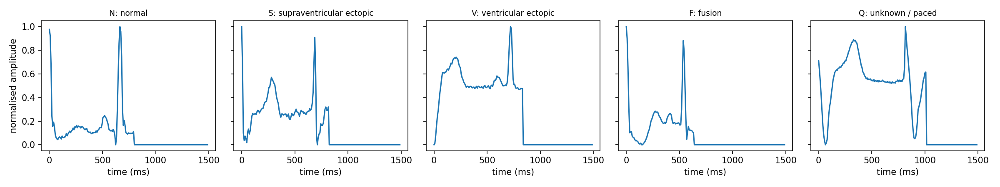
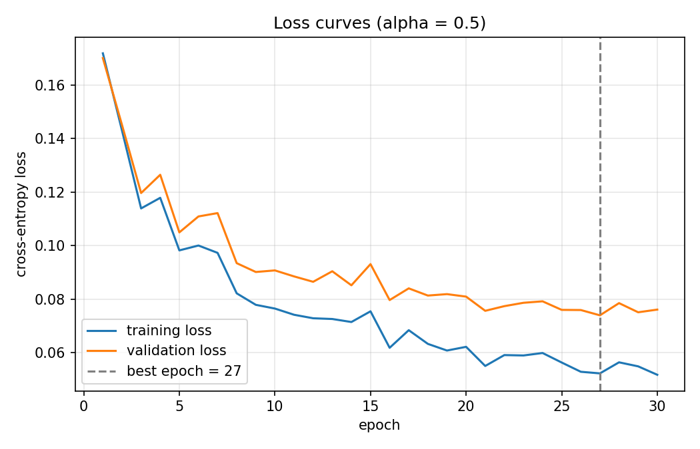
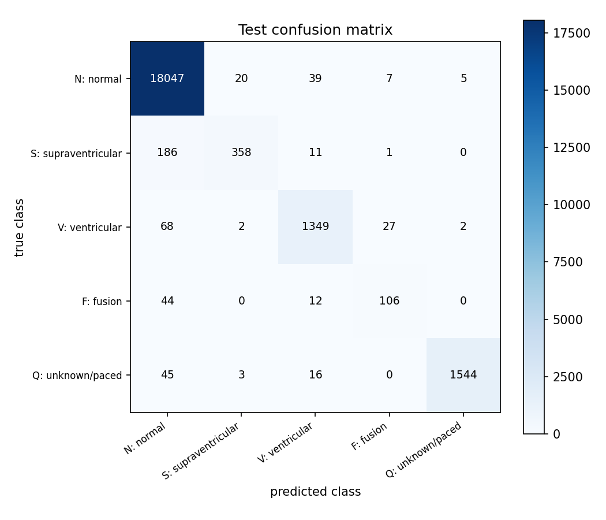

# ECG Heartbeat Classifier

A from-scratch neural network built with PyTorch to classify ECG heartbeat samples into five MIT-BIH heartbeat categories: **N, S, V, F, and Q**. This project was completed for **Applied Machine Learning (AML), Assignment 3 — Fall 2026**.

The model uses 187 input features and is trained using a manually implemented training workflow. The assignment includes gradient verification, learning-rate comparison, test evaluation, and analysis of class imbalance.

## Project Highlights

- Five-class ECG heartbeat classification: N, S, V, F, Q
- Neural network implemented in PyTorch
- 187 input features (label excluded)
- He initialization
- Gradient check against PyTorch autograd
- Learning-rate experiments: 0.01, 0.1, and 0.5
- Evaluation using accuracy, balanced accuracy, per-class accuracy, and a confusion matrix

## Dataset

The project uses ECG heartbeat data associated with the **MIT-BIH** dataset. The supplied results summary reports the following split sizes:

| Split | Number of rows |
|---|---:|
| Training | 78,799 |
| Validation | 8,755 |
| Test | 21,892 |
| **Total** | **109,446** |

Signal values range from **0.0 to 1.0**. The five labels are:

| Label | Class |
|---|---|
| N | Normal |
| S | Supraventricular ectopic |
| V | Ventricular ectopic |
| F | Fusion |
| Q | Unknown / other |

### Class distribution

Counts in the training file and test split:

| Class | Training file | Test split |
|---|---:|---:|
| N | 72,471 | 18,118 |
| S | 2,223 | 556 |
| V | 5,788 | 1,448 |
| F | 641 | 162 |
| Q | 6,431 | 1,608 |

The dataset is imbalanced. In particular, the F class is rare, with 641 rows in the training file compared with 72,471 N rows.

## Model Architecture

The network has three fully connected layers:

```text
Input: 187 features
       |
Fully Connected: 187 -> 128
       |
ReLU
       |
Fully Connected: 128 -> 64
       |
ReLU
       |
Fully Connected: 64 -> 5
       |
Output: 5 class logits
```

The network contains **32,645 trainable parameters**. The output layer produces logits for the five heartbeat classes.

## Training

| Setting | Value |
|---|---:|
| Selected learning rate (α) | 0.5 |
| Best epoch | 27 |
| Total epochs | 30 |
| Batch size used for step-count calculation | 128 |
| Training time | 39.2 seconds |
| Hardware | Tesla T4 |
| Initial loss | 1.7174 |
| Train loss at best epoch | 0.0523 |
| Validation loss at best epoch | 0.0740 |
| Train accuracy at best epoch | 98.34% |
| Validation accuracy at best epoch | 98.02% |

### Learning-rate comparison

| Learning rate (α) | Lowest validation loss | Validation accuracy | Epoch |
|---:|---:|---:|---:|
| 0.01 | 0.1618 | 95.80% | 30 |
| 0.1 | 0.0877 | 97.54% | 28 |
| 0.5 | 0.0740 | 98.02% | 27 |

The learning rate **0.5** achieved the lowest validation loss among the tested values.

## Test Results

| Metric | Result |
|---|---:|
| Test accuracy | **97.77%** |
| Balanced accuracy | **83.72%** |
| Always-predict-N baseline accuracy | 82.76% |

The difference between overall and balanced accuracy reflects the class imbalance: overall accuracy is strongly influenced by the large N class.

### Per-class accuracy

| Class | Accuracy |
|---|---:|
| N | 99.61% |
| S | 64.39% |
| V | 93.16% |
| F | 65.43% |
| Q | 96.02% |

S has the lowest per-class accuracy, followed by F. Both classes are often misclassified as N.

### Confusion matrix

Rows are true labels and columns are predicted labels.

| True \ Predicted | N | S | V | F | Q |
|---|---:|---:|---:|---:|---:|
| N | 18,047 | 20 | 39 | 7 | 5 |
| S | 186 | 358 | 11 | 1 | 0 |
| V | 68 | 2 | 1,349 | 27 | 2 |
| F | 44 | 0 | 12 | 106 | 0 |
| Q | 45 | 3 | 16 | 0 | 1,544 |

### Comparison with the always-N baseline

An always-N classifier achieves 82.76% test accuracy, but it identifies none of the abnormal beats. The trained model achieves 97.77% test accuracy and:

- Labels 3,431 of 3,774 abnormal beats as a class other than N (90.9%).
- Correctly classifies 3,357 abnormal beats (88.9%).
- Produces 71 false alarms among 18,118 normal beats (0.39%).

## Validation Loss During Training

| Epoch | Training loss | Validation loss | Validation − training |
|---:|---:|---:|---:|
| 1 | 0.1719 | 0.1701 | -0.0018 |
| 10 | 0.0765 | 0.0908 | +0.0143 |
| 20 | 0.0622 | 0.0810 | +0.0188 |
| 27 (best) | 0.0523 | 0.0740 | +0.0217 |
| 30 | 0.0518 | 0.0761 | +0.0243 |

Validation loss reached its minimum at epoch 27. By epoch 30, training loss continued to decrease while validation loss increased slightly, indicating a modest widening of the generalization gap.

## Verification

The implementation's reported checks:

- Input feature count: 187
- Trainable parameter count: 32,645
- Initial loss: 1.7174 (near the five-class uniform-prediction loss, log(5) ≈ 1.6094)
- Gradient differences for the checked weights and biases: 0.000e+00
- Confusion matrix total: 21,892 test rows
- Test accuracy: 97.77%

The exact zero gradient difference is reported in the results summary; with batch size 64, division by the batch size is exact in floating-point arithmetic, and the hand-derived calculation follows the same operations as autograd.

## Repository Structure

> Update this section to match the final files in your GitHub repository.

```text
.
├── data/                  # Dataset files (not necessarily committed)
├── results/               # Figures, metrics, and evaluation outputs
├── src/                   # Model, training, and evaluation code
├── app/                   # Assignment front-end (if implemented)
└── README.md
```

## How to Run

The exact script names and commands were not included in the supplied results summary. After adding the project files to the repository, update this section with the commands used in your implementation.

A typical environment requires:

- Python
- PyTorch
- NumPy
- pandas
- Matplotlib

Install dependencies (if a `requirements.txt` is provided):

```bash
pip install -r requirements.txt
```

Then run the project's training and evaluation scripts using the commands documented in the repository.

## Results and Figures

Add your generated figures to `results/` and link them here. The supplied results summary notes that Figures 2–4 should be available in `results/` or regenerated by running the training and testing scripts.

Example Markdown image links (adjust filenames as needed):

```markdown



```

## Conclusion

The neural network achieved **97.77% test accuracy** on the five-class ECG heartbeat classification task. Balanced accuracy was **83.72%**, revealing that the model's performance is less uniform across classes than the overall accuracy suggests. The S and F classes remain challenging, particularly because they are rare and are frequently predicted as N. These results show why per-class metrics and the confusion matrix are important alongside overall accuracy.

## Assignment

**Course:** Applied Machine Learning (AML)  
**Assignment:** 3 — ECG Heartbeat Classifier  
**Semester:** Fall 2026
